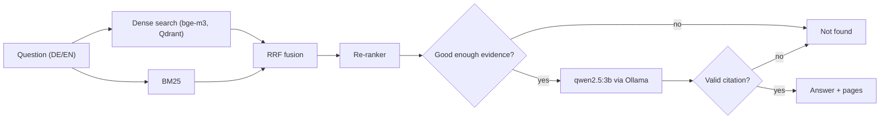

# MedRAG-DE

A local question-answering assistant for public medical guidelines from WHO and RKI/STIKO. You can
ask in German or English. It answers with the page it got the answer from, or says it found
nothing. Everything runs on my laptop (Apple M3, 8 GB RAM), with no cloud API.

> Demo project, **not medical advice**. Don't use it for health decisions.

<!-- Demo GIF goes here: docs/assets/demo.gif (record with Cmd+Shift+5, convert with
     ffmpeg -i demo.mov -vf "fps=10,scale=900:-1" docs/assets/demo.gif) -->

Example from the evaluation run:

> **Q:** Für wen empfiehlt die STIKO die RSV-Impfung als Standardimpfung?
>
> **A:** Die STIKO empfiehlt die RSV-Impfung als Standardimpfung für Personen ≥ 75 Jahre [STIKO-Empfehlungen 2026 (Epid Bull 4/2026), p. 3].

## Results

I built a set of 40 test questions (drafted with an LLM) and checked each one by hand against the
PDFs: 30 answerable (8 of them
asked in the other language than the document), and 10 that the documents can't answer. Then I
compared four retrieval modes with the same LLM and prompt. Method and failure cases are in
[docs/EVALUATION.md](docs/EVALUATION.md).

<!-- RESULTS:START -->
| Mode | Recall@5 | MRR@10 | Faithfulness | Answer relevancy | Refusal (unanswerable) | False refusal (answerable) | Median latency |
|---|---|---|---|---|---|---|---|
| `dense` | 0.83 | 0.77 | 0.98 | 0.84 | 100 % | 7 % | 9.0 s |
| `bm25` | 0.67 | 0.54 | 1.00 | 0.79 | 90 % | 37 % | 7.5 s |
| `hybrid` | 0.90 | 0.68 | 0.88 | 0.82 | 100 % | 20 % | 7.8 s |
| `hybrid_rerank` | 0.97 | 0.83 | 0.95 | 0.84 | 90 % | 7 % | 8.8 s |

**By question language** (Recall@5 / false-refusal rate / faithfulness)

| Mode | German questions | English questions |
|---|---|---|
| `dense` | 0.80 / 7 % / 0.96 | 0.87 / 7 % / 1.00 |
| `bm25` | 0.73 / 40 % / 1.00 | 0.60 / 33 % / 1.00 |
| `hybrid` | 0.87 / 20 % / 0.85 | 0.93 / 20 % / 0.92 |
| `hybrid_rerank` | 1.00 / 7 % / 0.96 | 0.93 / 7 % / 0.93 |

Measured on 40 human-verified golden-set items (30 answerable, 10 unanswerable; 20 German, 20 English questions), 2026-11-06 21:34 UTC. Hardware: Apple M3, 8 GB RAM, Darwin arm64. LLM: `ollama:qwen2.5:3b`, judge: `ollama:qwen2.5:7b`, embeddings: `BAAI/bge-m3`, re-ranker: `cross-encoder/mmarco-mMiniLMv2-L12-H384-v1`, top-k 5. Faithfulness and answer relevancy are averaged over answered questions only. Details: [docs/EVALUATION.md](docs/EVALUATION.md).
<!-- RESULTS:END -->

All numbers come from `make eval` in this repo. The default mode is `hybrid_rerank`.

## How it works



The PDFs are split per page into chunks of about 1000 characters and stored in Qdrant (1153 chunks
from 7 documents). For a question, dense search and BM25 each return 30 candidates. I fuse them
with Reciprocal Rank Fusion and re-rank the top 20 with a small multilingual cross-encoder. The
best 5 chunks go to the LLM as numbered sources.

## Design decisions

- **The model cites numbers, my code writes the citations.** The LLM only writes `[2]`. The code
  turns that into title and page and drops numbers that don't exist. This way a 3B model can't make
  up a page number.
- **"Not found" is checked in code.** If the best re-ranker score is too low, the LLM is never
  called. An answer without a valid citation also counts as "not found". I set the thresholds with
  9 separate questions that are not in the test set.
- **Hybrid plus re-ranking, because the numbers said so.** Dense search alone had Recall@5 0.83.
  Adding BM25 raised it to 0.90 but made the ranking worse (MRR 0.77 → 0.68). The re-ranker fixed
  that (0.97 / 0.83).
- **Built around 8 GB of RAM.** Ollama runs natively so it can use the GPU. The embedder and
  re-ranker run on the CPU. Question length, context size, top-k and timeout are enforced in the
  API, not only in the prompt.
- **No PDFs in Git.** `data/manifest.yaml` has the download URL, licence and sha256 of each
  document, and ingestion stops if a file doesn't match.

## What I learned

- BM25 found the right page for **0 of 8** cross-lingual questions. German words simply don't appear
  in English text. Dense search with bge-m3 found 7 of 8.
- My first RAGAS judge (qwen2.5:3b) marked a correct, cited answer as unsupported, so I switched to
  qwen2.5:7b. That took about 2 hours on this laptop.
- Faithfulness isn't correctness. For a chickenpox question, BM25 retrieved a passage about
  rabies. The LLM copied the incubation period, and the judge still gave it 1.0 because the numbers
  were in the context.
- The bigger bge-reranker-v2-m3 kept running out of memory next to the LLM. The smaller MiniLM
  re-ranker made retrieval about 1 s per question.

## Quickstart

Needs [uv](https://docs.astral.sh/uv/), [Docker](https://www.docker.com/) and
[Ollama](https://ollama.com/).

```bash
git clone https://github.com/mvskpranav11/medrag-de.git && cd medrag-de
make setup                     # Python deps, pulls qwen2.5:3b (and qwen2.5:7b for make eval)
docker compose up -d qdrant
make ingest                    # downloads and indexes the 7 PDFs
make up                        # API + UI → http://localhost:8501
```

The first `make up` downloads the model weights, so it takes a while. API docs are at
<http://localhost:8000/docs>. Settings are environment variables, see [.env.example](.env.example).
`LLM_PROVIDER=openai` switches to an OpenAI-compatible API, but it's off by default.

## Limitations

- The 3B model wrongly refuses 7 % of answerable questions and its German is sometimes clumsy.
- 40 questions is a small test set. One question changes Recall@5 by 3.3 points.
- Tables in the PDFs get flattened, and there is no OCR. Page numbers are PDF pages, not the printed
  journal pages.
- Median latency is 8.8 s on my laptop, mostly the LLM writing. In Docker it is slower (not
  measured).

## Sources

The documents are downloaded by `make ingest` and are not part of this repo.

| Document | Lang | Licence |
|---|---|---|
| [WHO Guidelines on Physical Activity and Sedentary Behaviour (2020)](https://iris.who.int/handle/10665/336656) | EN | [CC BY-NC-SA 3.0 IGO](https://creativecommons.org/licenses/by-nc-sa/3.0/igo) |
| [WHO Guideline for the Pharmacological Treatment of Hypertension in Adults (2021)](https://iris.who.int/handle/10665/344424) | EN | [CC BY-NC-SA 3.0 IGO](https://creativecommons.org/licenses/by-nc-sa/3.0/igo) |
| [STIKO-Empfehlungen 2026 (Epid Bull 4/2026)](https://edoc.rki.de/handle/176904/13181.5) | DE | [CC BY 4.0](https://creativecommons.org/licenses/by/4.0/) |
| [RKI JoHM – Körperliche Aktivität in der Freizeit bei Erwachsenen (2017)](https://edoc.rki.de/handle/176904/2650) | DE | [CC BY 4.0](https://creativecommons.org/licenses/by/4.0/) |
| [RKI JoHM – 12-Monats-Prävalenz von Bluthochdruck in Deutschland (2017)](https://edoc.rki.de/handle/176904/2581) | DE | [CC BY 4.0](https://creativecommons.org/licenses/by/4.0/) |
| [RKI JoHM – Wie viel sitzen Erwachsene? (2022)](https://edoc.rki.de/handle/176904/10233) | DE | [CC BY 4.0](https://creativecommons.org/licenses/by/4.0/) |
| [RKI JoHM – Bewegung und Bewegungsförderung in Deutschland (2025)](https://edoc.rki.de/handle/176904/13086) | DE | [CC BY 4.0](https://creativecommons.org/licenses/by/4.0/) |

Not affiliated with WHO or RKI.

## Licence

Code under MIT, see [LICENSE](LICENSE). The documents keep their own licences.
