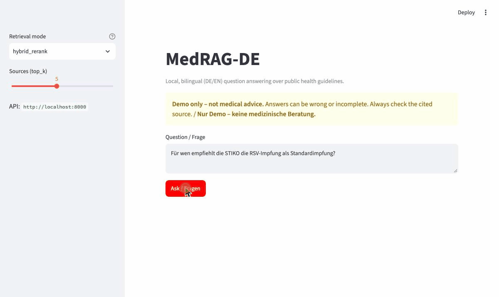
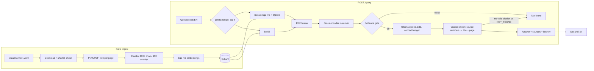

# MedRAG-DE

**A fully local, bilingual (German/English) RAG assistant for public medical guidelines. It answers
with page-level citations, says "not found" when the documents don't contain the answer, and comes
with an honest evaluation.**


-orange)

> **Disclaimer:** This is a demo project. It is **not medical advice** and must not be used for
> diagnosis or treatment decisions. Always consult a qualified health professional.

<!-- Demo GIF: record it, save it as docs/assets/demo.gif, then replace this comment with
     
     How to record (macOS): `make up`, open http://localhost:8501, press Cmd+Shift+5 → "Record
     selected portion", ask one German and one English question and one off-topic question
     ("not found"), stop. Convert: `ffmpeg -i demo.mov -vf "fps=10,scale=900:-1" docs/assets/demo.gif`
     (keep it under ~5 MB). -->
*Demo GIF: not recorded yet. See the comment in this README for how to record it.*

Ask *"Ab welchem Alter wird die RSV-Impfung empfohlen?"* or *"What blood pressure target does WHO
recommend?"*. You get a short answer in the language of the question, with sources like
`[STIKO-Empfehlungen 2026 (Epid Bull 4/2026), p. 3]`. If the documents don't cover the question,
the answer is *"Dazu habe ich in den Dokumenten nichts gefunden."* / *"Not found in the documents."*

## Results

Four retrieval modes, same LLM and prompt, on 40 human-verified questions (30 answerable,
10 unanswerable; 8 cross-lingual). Full method and five failure cases:
[docs/EVALUATION.md](docs/EVALUATION.md).

<!-- RESULTS:START -->
| Mode | Recall@5 | MRR@10 | Faithfulness | Answer relevancy | Refusal (unanswerable) | False refusal (answerable) | Median latency |
|---|---|---|---|---|---|---|---|
| `dense` | 0.83 | 0.77 | 0.98 | 0.84 | 100 % | 7 % | 9.0 s |
| `bm25` | 0.67 | 0.54 | 1.00 | 0.79 | 90 % | 37 % | 7.5 s |
| `hybrid` | 0.90 | 0.68 | 0.88 | 0.82 | 100 % | 20 % | 7.8 s |
| `hybrid_rerank` | 0.97 | 0.83 | 0.95 | 0.84 | 90 % | 7 % | 8.8 s |

**By question language** (Recall@5 / false-refusal rate / faithfulness)

| Mode | German questions | English questions |
|---|---|---|
| `dense` | 0.80 / 7 % / 0.96 | 0.87 / 7 % / 1.00 |
| `bm25` | 0.73 / 40 % / 1.00 | 0.60 / 33 % / 1.00 |
| `hybrid` | 0.87 / 20 % / 0.85 | 0.93 / 20 % / 0.92 |
| `hybrid_rerank` | 1.00 / 7 % / 0.96 | 0.93 / 7 % / 0.93 |

Measured on 40 human-verified golden-set items (30 answerable, 10 unanswerable; 20 German, 20 English questions), 2026-11-06 21:34 UTC. Hardware: Apple M3, 8 GB RAM, Darwin arm64. LLM: `ollama:qwen2.5:3b`, judge: `ollama:qwen2.5:7b`, embeddings: `BAAI/bge-m3`, re-ranker: `cross-encoder/mmarco-mMiniLMv2-L12-H384-v1`, top-k 5. Faithfulness and answer relevancy are averaged over answered questions only. Details: [docs/EVALUATION.md](docs/EVALUATION.md).
<!-- RESULTS:END -->

The default mode is `hybrid_rerank`. Every number above was produced by `make eval` in this
repository. Nothing is copied from elsewhere.

## Why

- **Privacy.** Health questions are sensitive. Everything runs on your machine: the LLM (Ollama),
  embeddings, re-ranker and vector store. No question leaves the device unless you explicitly switch
  `LLM_PROVIDER=openai`.
- **German and English.** German guidelines (RKI/STIKO) and international ones (WHO) answer
  different questions. A user should be able to ask in either language and get an answer from
  either source.
- **Trust.** An answer about vaccination or blood pressure is only useful if you can check it. So
  every claim cites a page, and the system would rather say "not found" than guess.

## Architecture



| Component | Choice |
|---|---|
| PDF parsing | PyMuPDF, page by page (keeps page numbers) |
| Embeddings | `BAAI/bge-m3` (multilingual, 1024-dim) via sentence-transformers |
| Vector store | Qdrant (Docker) |
| Keyword search | `rank_bm25`, built from the Qdrant payloads |
| Fusion / re-ranking | Reciprocal Rank Fusion (k = 60), `cross-encoder/mmarco-mMiniLMv2-L12-H384-v1` |
| LLM | `qwen2.5:3b` via Ollama, temperature 0. Optional OpenAI-compatible API |
| API / UI | FastAPI + Pydantic, Streamlit |
| Evaluation | Own Recall@5 / MRR@10 / refusal metrics + RAGAS with a local `qwen2.5:7b` judge |

## Quickstart

Needs [uv](https://docs.astral.sh/uv/), [Docker](https://www.docker.com/) and
[Ollama](https://ollama.com/) (native Ollama, so it can use the Mac GPU).

```bash
git clone <repo-url> medrag-de && cd medrag-de
make setup                     # Python deps + ollama pull (qwen2.5:3b, and the qwen2.5:7b judge for make eval)
docker compose up -d qdrant
make ingest                    # downloads 7 PDFs, checks sha256, indexes 1153 chunks
make up                        # API + UI in Docker → http://localhost:8501
```

The first `make up` builds the image and downloads the embedding and re-ranker weights (several GB),
so it takes a while. API docs: <http://localhost:8000/docs>. Example request:

```bash
curl -s localhost:8000/query -H 'Content-Type: application/json' \
  -d '{"question": "Ab welchem Alter wird die RSV-Impfung empfohlen?", "mode": "hybrid_rerank", "top_k": 5}'
```

Other targets: `make test`, `make lint`, `make eval`, `make api` / `make ui` (run without Docker),
`make down`. All settings are environment variables. See [.env.example](.env.example).

## Design decisions

1. **Hybrid retrieval with a re-ranker as the default.** Dense search handles meaning and other
   languages. BM25 handles exact terms like *PCV20* or *Tdap*. Plain fusion alone hurt the ranking
   (MRR@10 0.68 vs 0.77 for dense), and the cross-encoder fixed it (0.83, Recall@5 0.97). That is
   measured, not assumed, so the default follows the measurement.
2. **"Not found" is enforced in code, not only in the prompt.** Three layers: an evidence gate on
   the best dense / re-ranker score (the LLM is not called at all), an explicit `NOT_FOUND` reply,
   and a rule that an answer without a valid citation counts as not found. The thresholds were
   calibrated on separate questions, not on the test set.
3. **The LLM cites numbers, the code writes the citations.** The model only writes `[2]`. The code
   maps that to *title, page*, drops numbers that don't exist and merges duplicates from the same page.
   A small model can't invent a page number this way.
4. **Multilingual embeddings instead of translation.** bge-m3 puts German questions and English
   text in the same vector space. BM25 alone found the right page for 0 of 8 cross-lingual questions,
   while dense and re-ranked hybrid found it for 7 of 8.
5. **Sized for an 8 GB laptop.** Ollama runs natively and uses the GPU. Embedder and re-ranker run on
   the CPU at query time, and the re-ranker is a small multilingual MiniLM (the larger
   bge-reranker-v2-m3 caused out-of-memory and swapping). The API runs one query at a time.
   Question length (500 chars), context budget (3000 tokens), top-k (≤ 20) and request timeout
   (60 s) are checked in code, so bad input gets a 422 and a timeout gets a 504.
6. **Licences and reproducibility first.** No PDFs in Git. `data/manifest.yaml` lists URL, licence and
   sha256, and ingestion refuses files that don't match. Re-running ingestion replaces a document's
   chunks instead of duplicating them. Evaluation results store chunk IDs, not document text.

## Limitations

- **Small LLM.** qwen2.5:3b sometimes refuses answerable questions (7 % in the default mode) and
  writes clumsy German. It once inferred a "sleep recommendation" from an off-topic passage. See the
  failure cases in [docs/EVALUATION.md](docs/EVALUATION.md).
- **Small test set.** 40 questions on 7 documents, one run, no confidence intervals. One answerable
  question moves Recall@5 by 3.3 points.
- **Faithfulness ≠ correctness.** The RAGAS judge (qwen2.5:7b) checks whether the answer is supported
  by the retrieved text. An answer that copies the right numbers about the wrong disease still scores
  1.0 (failure case 3).
- **Text-only PDF parsing.** Tables and multi-column layouts are flattened, and there is no OCR. Page
  numbers are PDF page indices, not printed journal pages.
- **Latency.** The 7.5–9 s median was measured natively on an 8 GB Apple M3. With `make up`, Ollama
  still runs natively, but retrieval runs inside Docker's Linux VM. It was clearly slower in manual
  tests (not measured systematically).
- **Not a medical product.** No clinical validation, no safety review, no guarantee that the
  documents are current.

## Data sources and licences

The PDFs are **not** in this repository. `make ingest` downloads them from the publishers and checks
each file's sha256 against [data/manifest.yaml](data/manifest.yaml). Licences were checked in each
PDF itself.

| Document | Language | Licence |
|---|---|---|
| [WHO Guidelines on Physical Activity and Sedentary Behaviour (2020)](https://iris.who.int/handle/10665/336656) | EN | [CC BY-NC-SA 3.0 IGO](https://creativecommons.org/licenses/by-nc-sa/3.0/igo) |
| [WHO Guideline for the Pharmacological Treatment of Hypertension in Adults (2021)](https://iris.who.int/handle/10665/344424) | EN | [CC BY-NC-SA 3.0 IGO](https://creativecommons.org/licenses/by-nc-sa/3.0/igo) |
| [STIKO-Empfehlungen 2026 (Epid Bull 4/2026)](https://edoc.rki.de/handle/176904/13181.5) | DE | [CC BY 4.0](https://creativecommons.org/licenses/by/4.0/) |
| [RKI JoHM – Körperliche Aktivität in der Freizeit bei Erwachsenen (2017)](https://edoc.rki.de/handle/176904/2650) | DE | [CC BY 4.0](https://creativecommons.org/licenses/by/4.0/) |
| [RKI JoHM – 12-Monats-Prävalenz von Bluthochdruck in Deutschland (2017)](https://edoc.rki.de/handle/176904/2581) | DE | [CC BY 4.0](https://creativecommons.org/licenses/by/4.0/) |
| [RKI JoHM – Wie viel sitzen Erwachsene? (2022)](https://edoc.rki.de/handle/176904/10233) | DE | [CC BY 4.0](https://creativecommons.org/licenses/by/4.0/) |
| [RKI JoHM – Bewegung und Bewegungsförderung in Deutschland (2025)](https://edoc.rki.de/handle/176904/13086) | DE | [CC BY 4.0](https://creativecommons.org/licenses/by/4.0/) |

© World Health Organization (WHO documents) and Robert Koch-Institut (RKI documents). This project is
not affiliated with or endorsed by WHO or RKI.

## Disclaimer

MedRAG-DE is a portfolio and learning project. Its answers can be incomplete, outdated or wrong. It
is **not medical advice** and not a medical device. Do not use it to make health decisions.

## Licence

Code: MIT, see [LICENSE](LICENSE). The source documents keep their own licences (table above).
